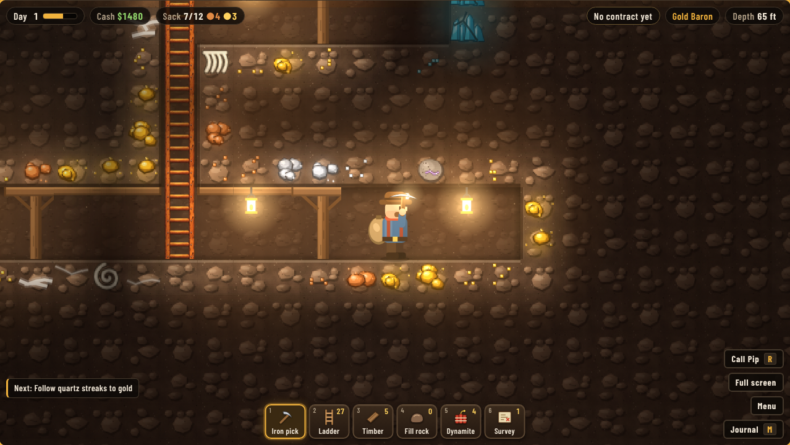
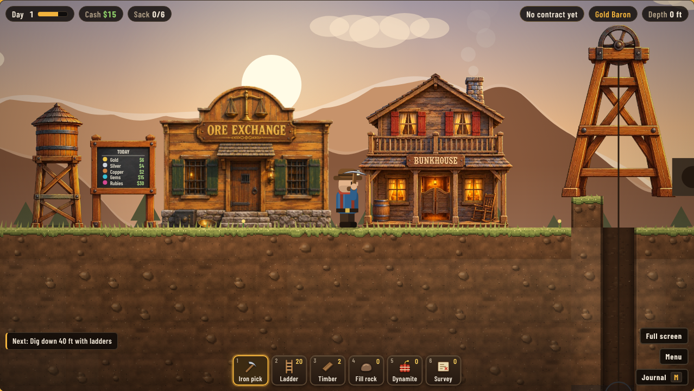

# Deepvein

A gold rush mining game that sneaks in multiplication practice.

You run Claim 7. Dig shafts, shore up the roof before it caves in, pump out the
groundwater, haul your ore to the surface and sell it. Somewhere at the bottom
of the claim lies the Mother Lode, and McGraw's crew next door is digging for it
too.

It was built for a 10-year-old who loves mining, machines and gems. The goal was
a game that is about 90% fun and 10% times tables, where knowing your facts is
how you get ahead rather than a quiz that interrupts the game.

**[Play Deepvein](https://g12r.github.io/etc-deepvein/)** — runs in the browser,
nothing to install.



## What you do

- **Dig a real mine.** Sink shafts, climb them on ladders, and prop tunnels with
  timber. Roofs that span too far creak, then cave in.
- **Read the rock.** Ore is hidden. White quartz streaks mean gold is near, and
  bright flecks mean it is next door. A survey kit shows a patch of rock.
- **Find more than gold.** Copper near the top, silver below it, gems in deep
  rock, rubies in granite, geodes to crack open, and fossils for a museum
  collection.
- **Work a day at a time.** The lamp holds one day of oil. Sell when the gold
  price is good, pick a contract, sleep at the bunkhouse.
- **Build the operation.** Hoists, conveyor belts, ore carts on rails, an
  elevator, steam pumps and a steam drill.
- **Choose how you grow.** Every promotion and every mastered times table earns
  a perk, picked from three.
- **Get out of trouble.** Out of ladders at the bottom of a shaft? Pip the pack
  rat runs some down from the store, at double price, on credit.



## Where the math lives

Only multiplication, and only the 1 to 10 times tables: 100 facts.

| Where | What the fact does |
| --- | --- |
| Selling ore | Work out the weigh-in and the assayer pays 50% more, or 75% more in under 3 seconds |
| Cracking geodes | Each geode is one fact. A streak of right answers pays more each time |
| Dynamite | Count the charges to arm it. A fast answer bores deeper |
| Survey kit | Work out the area of the patch to scan it |
| The store | Count the cost of a bundle and get extras for free |
| Pip the pack rat | Check the bill and Pip packs one extra |

The game tracks every fact. It asks new and shaky ones more often, and mastered
ones only now and then. Three fast correct answers turn a fact to gold on the
"Mother Lode map", a 10 by 10 grid under the game that shows a parent where
things stand. At the geode saw the player can pick one table to work on.

Skipping the math is always allowed. It just pays less.

## Controls

| Key | Action |
| --- | --- |
| `A` `D` | Walk |
| `W` `S` | Climb, swim, or ride the elevator |
| `Space` | Jump |
| Mouse | Hold to dig. Click to place the selected tool; drag to place ladders, rails, belts and fill |
| `1`–`0`, `L` | Pick a tool |
| `E` | Use what you are standing at: store, ore exchange, bunkhouse, hoist, cart |
| `R` | Call Pip the pack rat (underground) |
| `M` | Journal: claim map, fact map, perks, trophies, museum |

There is a full screen button at the bottom right. The claim saves in the
browser, so it is tied to the address the game is played from.

## Versions

| Link | Version |
| --- | --- |
| [deepvein.html](https://g12r.github.io/etc-deepvein/deepvein.html) | The newest build |
| [releases/deepvein-2.0.html](https://g12r.github.io/etc-deepvein/releases/deepvein-2.0.html) | Deepvein 2.0 |
| [releases/deepvein-1.0.html](https://g12r.github.io/etc-deepvein/releases/deepvein-1.0.html) | Deepvein 1.0, the original |

A claim saved in an older version carries over when a newer one is opened at the
same address. The git history follows the same versions: the 1.0 and 2.0 commits
change the same files, so the diff between them is the story of what changed.

## Working on it

The game is one self-contained HTML page with no dependencies beyond web fonts.
It is built from four source files:

| File | What it holds |
| --- | --- |
| `src/head.html` | Page markup and styles |
| `src/helpers.js` | Colour and sound helpers |
| `src/tiles.js` | Tile and ore art, drawn in code |
| `src/game.js` | The game |
| `art/*.webp` | Painted images for the town buildings, windmill, water tower, hoist frame, price board and ladder |

Build the page with:

```bash
python3 build.py
```

That writes `deepvein.html`, with the images in `art/` embedded so it stays one self-contained file. Everything else on screen is drawn by code.

The painted images were generated on a plain green background (the originals are in `art/source/`). `python3 tools/make_art.py` keys the green out, splits the sheets and writes the pieces to `art/`. It needs Pillow and NumPy. If an image is missing, the game falls back to drawing that thing in code.

GitHub Pages serves the repository root from
`main`, so a pushed build is live a minute or two later.

### Tests

`tests/` holds scripted playtests that drive the built page in a headless
browser. They need Node and Playwright with Chromium.

```bash
cd tests
node systems.js
```

Each script prints what it checked and any page errors. `tests/fixtures/` holds
older builds of the game, used to make saved claims for the carry-over tests.

## Credits

Designed by a parent and a 10-year-old, and written with Claude.
